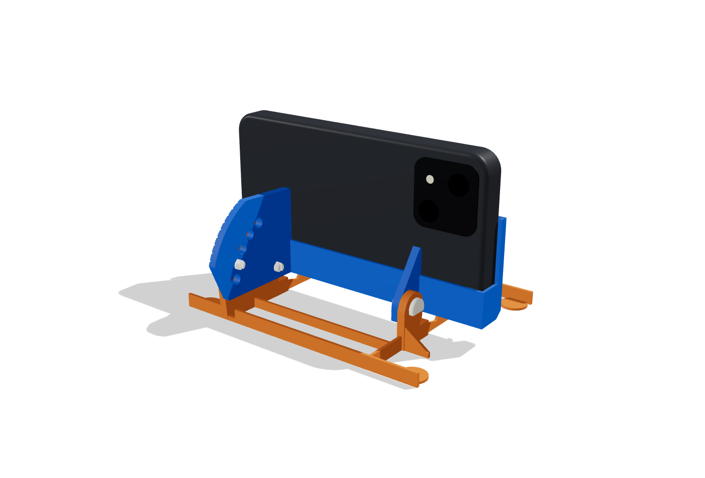
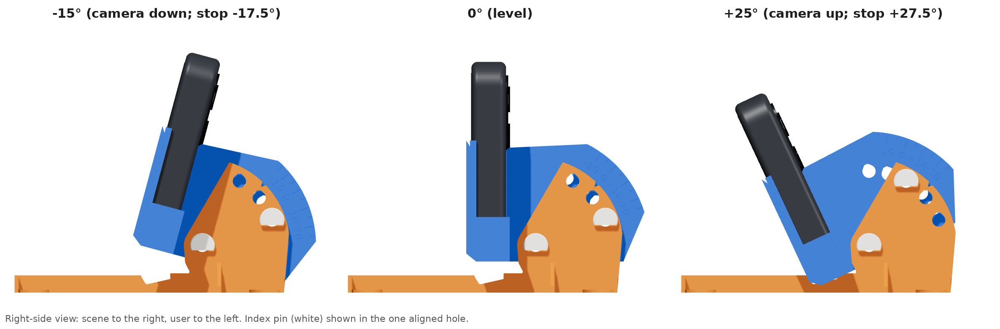

# iPhone 13 tilting tabletop camera stand

A three-part, support-free, printed-pin stand for an iPhone 13 **in its case**
(measured 148.6 × 76.8 × 14 mm), designed for a **FlashForge Adventurer 3 Lite**
(150 × 150 × 150 mm, 0.4 mm nozzle). The stand holds the phone in landscape with the
rear camera looking straight ahead at 0°, and tilts from **−15° (down) to +25° (up) in 5° steps**.
A printed pin locks each step positively.




| | |
|---|---|
| Parts to print | **base**, **cradle**, **4 snap pins** (2 pivot, 1 index, 1 spare) |
| Purchased hardware | **None required.** Optional: 4 small adhesive rubber bumpers (≤ 12 mm) under the corner feet; coins/washers if you print the optional ballast base |
| Estimated print time (PLA) | **5 h 11 min total** (2 h 39 m + 2 h 32 m), 29.2 g, 9.8 m of 1.75 mm filament |
| Footprint / height | 140 × 109 mm contact footprint; phone's lower edge 16.6 mm above the table; phone top ≈ 93 mm |

## Files

| File | What it is | Print orientation |
|---|---|---|
| `stl/plates/plate1_base_plus_4_pins.stl` | **Plate 1**: base with the 4 pins placed in its open rear bay | as exported |
| `stl/plates/plate2_cradle.stl` | **Plate 2**: cradle (same as `stl/cradle.stl`) | as exported: upright, **diagonal** |
| `stl/base.stl`, `stl/cradle.stl`, `stl/pins_x4.stl`, `stl/pin_single.stl` | the same parts individually | as exported |
| `stl/optional/base_with_ballast_cups.stl` | optional base variant with two Ø26.5 × 9 mm coin/washer cups (+38 min) | as exported |
| `preview/*.png` | renders: assembled views, tilt range, index close-up, both print plates | – |
| `cad/stand.py` | parametric CadQuery source, the single source of all geometry | – |
| `cad/validate.py`, `validation_report.txt/json` | geometric checks and their results | – |
| `slicer/*.ini`, `slicer/estimates.txt` | slicer settings used for the estimate, plus the raw results | – |

## Print settings and orientation

* **No supports and no brim.** All parts are already in the right print orientation; do not let the slicer auto-orient them.
* **Base:** flat, ribs and corner feet on the bed, cheeks pointing up.
* **Cradle:** upright, standing on its bottom edges with the open phone slot facing up. It is 152.6 mm long,
  so the STL is **pre-rotated 45°** to fit the bed diagonally (its footprint is 120 × 135 mm with ≥ 7.7 mm bed margin).
  Keep that rotation when you place it.
* **Pins:** lying on their flat side (the D-shaped flat on the shank and head), so the snap prongs flex in the strong direction.
* **Settings:** 0.2 mm layers, **0.4 mm line width, 2 walls**, 15 % infill, 5 top / 3 bottom layers.
  Most walls are exactly **1.5 mm thick, which prints as 2 clean perimeters**. That choice roughly halved the print time.
  If your slicer uses wider default lines (≥ 0.45 mm), set them to 0.4 mm, or thin walls may get gaps.
* **Elephant's foot:** keep compensation on (≈ 0.15 mm), or trim the first-layer flare on the cradle fins and base cheeks.
  They slide past each other with a 0.3 mm gap.
* **Material:** PLA is the recommended default (stiff and dimensionally accurate). PETG(+) also works, and its pins are more forgiving.
  Print the "high-speed" PETG+ at normal Adventurer 3 speeds; the Lite's nozzle tops out at 240 °C.

### Time and material estimate

Estimated with **PrusaSlicer 2.7.2 (CLI)** configured with OrcaSlicer's official profile values
`Flashforge Adventurer 3 Series 0.4 Nozzle` + `0.20mm Standard @Flashforge AD3 0.4 Nozzle`, plus its `Flashforge PLA/PETG @FF AD3`
cooling limits. Those values are: outer wall 30 mm/s, inner wall 42 mm/s, infill 60 mm/s, solid 30 mm/s,
**first layer 10 mm/s**, travel 80 mm/s, accelerations 50–150 mm/s², retraction 5 mm with 0.4 mm Z-hop,
and a 6 s (PLA) / 8 s (PETG) minimum layer time.
This is a slow, Adventurer-3-class profile, not a fast-printer profile (`slicer/adventurer3_*.ini`).

| Plate | PLA time | PLA mass | PETG time | PETG mass |
|---|---|---|---|---|
| 1 – base + 4 pins | 2 h 39 m | 14.9 g | 2 h 39 m | 15.3 g |
| 2 – cradle | 2 h 32 m | 14.2 g | 2 h 32 m | 14.6 g |
| **Total** | **5 h 11 m** | **29.2 g** (9.8 m) | **5 h 11 m** | **29.9 g** |
| Sensitivity: 0.18 mm layers / 0.27 mm first layer (FlashPrint-style) | 5 h 39 m | 29.1 g | | |
| Optional ballast-cup base instead of the base | +38 min | +4.6 g | | |

These are slicer estimates, not timed prints. FlashPrint uses its own motion model, so expect its number to differ
(a ±15–20 % spread is typical between slicers).

## Assembly

1. **Test-fit pins** in every hole before assembly. They should slide in by hand up to the snap bump.
   If a hole printed tight, ream it by hand with a 5.5 mm (or 7/32") drill bit.
2. Put the base on the table with its tall, scaled cheek on your **right** as you face the screen side.
   Lower the cradle **straight down** between the two cheeks. Its two fins go *inside* the cheeks, and its long beam sits behind them.
3. Line up the single **pivot hole** near the bottom of each fin/cheek pair. Push a pin in **from the outside** on each side until it clicks.
4. Tilt to the angle you want (below), then push the third pin in from the right through the one cheek hole that lines up.
5. Insert the phone **with the camera at the top-left as seen from the screen**: earpiece end on the left,
   volume buttons facing down, side button facing up. Lower it into the slot. The case's camera opening ends up top-right as seen from the scene.

### Setting the angle (vernier index)

The right fin carries a scale (−15 … +25, longer ticks with numbers every 10°). The base cheek has a **pointer notch**.

1. Hold the phone, pull the index pin out by its head, and tilt until the tick you want sits at the notch.
2. Look through the cheek's three index holes (A low/front, B middle, C top/rear). **Exactly one** will show a fin hole lined up behind it.
   The others are ≥ 2.6 mm off, so the pin cannot go into the wrong pair.
3. Push the pin in until it clicks.

| Tilt | −15 | −10 | −5 | 0 | +5 | +10 | +15 | +20 | +25 |
|---|---|---|---|---|---|---|---|---|---|
| Cheek hole | A | B | C | A | B | C | A | B | C |

With the pin out, gravity swings the cradle gently back to the **+27.5° hard stop** (camera up), which is still stable.
A second hard stop at −17.5° keeps the phone from ever reaching the cheek.
The intervals are 5° because the main camera's 16:9 frame is about ±20° vertically, so each step moves the framing by about 1/8 of the frame height.

## Design summary

* **Pivot** 12 mm in front of the phone's back face and 2.5 mm above its lower edge. The phone + cradle centre of
  gravity stays behind the pivot over the whole range, so the gravity torque never reverses (26–96 N·mm).
  The index pin is therefore always loaded the same way and returns the same angle every time.
* **Vernier index:** five fin holes 15° apart against three cheek holes 20° apart, both on a 30 mm radius.
  This gives nine 5° positions with Ø5 pins on a compact radius.
* **Phone retention:** the phone drops into a slot 14.6 mm wide × 149.6 mm long.
  * **Weight:** it rests on two pads: a rib 10 mm from the camera end, and the right fin under the button-free half of the lower edge.
  * **Camera side:** the two fin back-edges hold it, at x = ±40 mm and up to 28 / 42 mm high, well clear of the camera module.
  * **Screen side:** two 3.5 mm-wide end lips, 45 mm high, hold it. They overlap only the case rim and black border.
  * **Lengthwise:** low end walls (14 mm) stop it. The Lightning port, speaker and microphone on the right end stay open,
    so you can charge while recording.
* **Nothing touches the buttons** (lower edge from 13 to 73 mm from the camera end, and the whole upper edge)
  or the camera module. Nothing is in front of the lenses.

## Validation (calculated, not physical tests)

`python cad/validate.py stl` (full output in `validation_report.txt`). All of these are geometric or static calculations from the CAD model.
**None of the printed parts or the mechanism has been physically printed or tested.**

* **STL integrity:** all exported meshes are watertight and manifold, one body per part (plate 1 = 5 bodies).
  Every part fits the 150³ mm volume in its print orientation (≥ 5 mm margin).
  Downward overhangs steeper than 47° total < 100 mm², mostly the 1.5 mm-wide flat tops of the teardrop holes.
* **Fit at 0°:** phone/cradle overlap 0 mm³; button and camera keep-out zones are empty;
  the Lightning plug envelope (30 × 12.5 × 9 mm boot) clears the cradle.
* **Tilt sweep:** cradle + phone (with slot play) were swept against the base in 0.5° steps.
  They are collision-free from **−17.5° to +27.5°**, and the designed end stops engage just beyond that.
  Minimum running gaps are 0.3 mm (fin/cheek faces, by design) and ≥ 1.0 mm phone-to-base.
  Moving parts stay ≥ 3.0 mm above the table between −15° and +25°.
* **Pins:** at each of the 9 positions exactly one hole pair is concentric (0.000 mm), and every other pair is ≥ 2.62 mm off.
  Pins in their holes overlap nothing. The shank is 8.7 mm for the 8.3 mm plate stack, so the snap shoulder sits 0.4 mm past the fin's inner face.
  The snap bump interferes by 0.125 mm per side, taken up by the slotted prongs.
* **Camera field of view:** points sampled on every stand surface were checked against both lenses at all 9 tilts.
  The stand stays **3.6° outside the 0.5× ultra-wide 16:9 video frame** and **23° outside the 1× frame**.
  This used the full sensor-width field of view (13 mm / 26 mm equivalent), which is conservative because stabilization crops further.
  A 4:3 ultra-wide *photo* still clears by 0.8°.
* **Stability**, with the phone + case **assumed 300 g**. That is conservative: the iPhone 13 is 173 g, plus a case.
  Printed parts total 27.8 g:
  * **Centre of gravity:** inside the 140 × 109 mm footprint at every tilt, at most 55.5 mm above the table
    (the phone's own CoG is 55 mm up at 0°).
  * **Tipping angles:** ≥ 36.6° toward the scene (worst case −15°) and ≥ 47.4° backwards.
  * **Push to tip:** about 1.2–1.6 N horizontally at the phone's top edge.
  * **With the optional 68 g of coins:** ≥ 46.9° and 1.4–1.9 N.
* **Loads:** the index pin carries at most 3.2 N (at +25°) and each pivot pin about 3 N.
  At 4 mm bearing length those stresses are below 1 MPa, far below PLA strength.
  The worst-case angular backlash if both holes are at maximum clearance is about 1.3°.
  The one-directional torque keeps the play at the same side.

## Fit tolerances and untested assumptions

* **Clearances:** 0.5 mm at each end of the phone, 0.6 mm total in thickness (designed for 14.0 mm; a 13.5 mm case just leans ~1° more).
  Fin-to-cheek gap is 0.3 mm per side. Pin holes are Ø5.35 mm (teardrop) for Ø5.0 mm pins.
  Printed horizontal holes often come out 0.1–0.2 mm small; ream if needed.
* **Phone geometry not measured by you:** in-plane corner radius about 10 mm.
  Rear camera module about 4–39 mm from the camera end and 5.5–41 mm from the top edge (with case).
  No buttons on the lower edge within 12 mm of the camera end, nor anywhere past 75 mm from it.
  Please check with your phone in its case: the only lower-edge contacts are at **9–11 mm** and **112–116 mm** from the camera end,
  and the back is touched only by the beam along its lowest **14 mm** and by narrow strips **38–42 mm left and right of the centre**.
  All of these are parameters at the top of `cad/stand.py`.
* **Snap pins:** the insertion force (estimated 5–10 N) and the number of insert/remove cycles before the prongs loosen are untested.
  That is why you print a spare. PETG pins tolerate repeated snapping better than PLA.
* **Base:** the ribs are 1.5 mm thick. They are stiff enough on a table by calculation, but untested for rough handling.
  Lift the stand by the base, not the phone.
* **Thermal:** PLA softens around 55–60 °C. Don't leave it in a hot car. A phone that gets very warm while recording for a long time is better served by PETG.
* **Table:** the stand assumes a level, rigid table. Friction and sliding were not analysed. Rubber bumpers are optional.

## Reproducing / modifying

```bash
python3 -m venv venv && . venv/bin/activate
pip install cadquery trimesh manifold3d shapely rtree numpy scipy pillow
python cad/stand.py stl              # regenerate all STLs
python cad/validate.py stl           # run the checks
slicer/estimate.sh slicer/adventurer3_pla_0.2mm.ini /tmp/g stl/plates/*.stl   # needs prusa-slicer
```

Preview renders: `python cad/export_assembly.py cad/render/m && python cad/preview_scenes.py scenes.json preview`,
then serve `cad/render/` with `three@0.160.0` installed (`npm i three@0.160.0`) and run `node shoot.mjs scenes.json` (Playwright).
